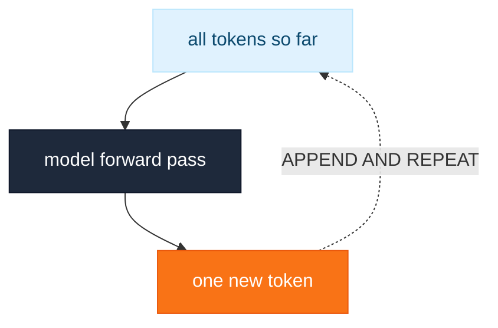
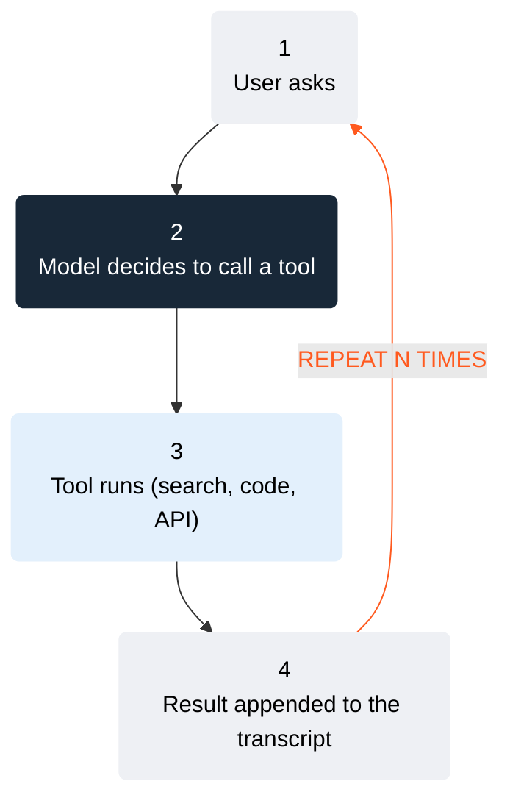

# 推理引擎到底做了啥？

## 0 前言

大多数人想象的：prompt 进，answer 出，中间有个 GPU。
讲者故意画得很 naive，为了后面打破它。关键问题是：

1. GPU 到底做了什么？
2. 为什么一个请求要跑很多次，而不是一次？
3. 100 个人同时来怎么办？

## 1 Tokens, not text

模型只看到整数。

Tokenize 在 CPU 上，GPU 还没参与。
例：`What are the top 3 things to do in NYC?` → `4827 553 290 2344 18 3283 316 621 306 47115 30`
1 token ≈ 3/4 个词，词表 ≈ 100k+。

### Tokenize = 词元化 / 分词处理

Tokenize指将输入文本转换成模型能够处理的 Token 序列。

如原始文本：

```bash
I love Java programming.
```

Tokenize 后可能变成：

```bash
["I", " love", " Java", " programming", "."]
```

Token 不一定等于一个单词，也可能是单词的一部分、标点符号，甚至单个字符。

#### 在大模型中，完整流程是什么？

```java
原始文本 Hello world
↓
Tokenize（词元化）切分成 Token
↓
Token ID 编码 每个 Token 映射为词表中的整数 ID
↓
模型处理 Embedding → Transformer → 输出 Token
```

Token 数量不等于单词数量，这也是大模型 API 计费、上下文窗口容量和推理性能分析中经常需关注概念。

大模型不认识字母，只认识编号，如：

```bash
# 英文 11 个词
What   are   the   top   3   things   to   do   in   NYC   ?
```

会被切成：

```bash
#  11 个 token
4827  553  290  2344  18  3283  316  621  306  47115  30
```

平均下来：

> **英文里 1 个 token ≈ 4 个字符 ≈ 0.75 个词**

同样信息量，中文 token 数通常相近或略多，因分词器而异。

#### `词表 ≈ 100k+` 是啥？咋定的 100k？

**词表 vocab = 模型认识的所有“碎片”清单。**

模型不是背整个英语字典，而是背 `subword` 碎片，如：

```
"mat" 是一个编号
"ing" 是一个编号  
" un" 是一个编号
" NYC" 是一个编号
```

你输入的任何句子，都只能用这份清单里的碎片拼出来。清单以外的东西，模型见都没见过。

那清单多大？就是人为定的超参数，训练 tokenizer 的时候定的：

1. 拿几百 GB 网页/代码去学 BPE
2. 从单个字母开始，把出现频率最高的相邻组合不断合并：`t+h → th`，`th+e → the`
3. 合并到你喊停为止。你喊停在 32k，就是 32k 词表；喊停在 128k，就是 128k 词表。

现在主流就是这个量级，所以 PPT 写 `100k+`：

- Llama2 / Mistral：32k
- Llama3：128k
- GPT-4o：约 200k
- Qwen3：约 150k

#### 为什么不小点 / 大点？

- **太小，比如 5k：** 碎得太碎了。`High Line` 可能要切成 6-7 个 token，序列超长，第2节那个 `一次一 token` 的循环要跑更多次，又慢又贵，还记不住长距离。
- **太大，比如 1M：** 每个编号都要占一个向量。最后一层要输出 `100k 个分数变 1 个 token`（第 10 节），词表 1M 就意味着每次要算 1M 个分数，显存和计算都爆炸。

所以 `100k` 就是个折中：**大部分常用词/词组是一个 token，生僻词用几个 token 拼出来。**

**词表是碎片字典，100k 是权衡后的超参数；token 是碎片编号，英文平均 0.75 词一个。**

## 2 THE LOOP - One forward pass, one token

预测下一个 token，拼回去，再跑一次。

| PASS       | 当前已有的所有 token（输入）   | 模型这次输出的新 token |
| ---------- | ------------------------------ | ---------------------- |
| **PASS 1** | The cat sat on the             | → mat                  |
| **PASS 2** | The cat sat on the mat         | → and                  |
| **PASS 3** | The cat sat on the mat and     | → the                  |
| **PASS 4** | The cat sat on the mat and the | → dog                  |

… 直到 stop token 或长度上限



自回归解码 autoregressive decoding。

- 模型一次只吐 1 个 token
- 这也是后面所有优化的根因

### 为什么要强调 PASS？

直接决定**延迟和成本**：

- 生成 500 个词的回答 ≈ 需要大约 700 次 PASS（因为英文 1 token ≈ 0.75 词）。
- 每次 PASS 都要完整跑一遍模型（虽然有 KV Cache 优化，但本质还是要跑）。
- 所以长回答会明显变慢，这也是为什么必须做流式输出（边生成边返回），否则用户要等几百次 PASS 全部跑完才能看到结果。

简单一句话： **PASS 1、PASS 2……就是「第 1 次、第 2 次……模型前向推理」**，每一次只产出 1 个新 token。

## 3 TWO PHASES - Prefill and decode

同一个模型，两种完全不同的负载。

### 3.1 Prefill COMPUTE-BOUND

整个 prompt 一次大的并行 pass，算出第一个 token。数学量大，GPU 核心打满。决定 `Time To First Token (TTFT)`。

```bash
┌─────┐ ┌─────┐ ┌─────┐ ┌────┐ ┌─────┐
│ The │ │ cat │ │ sat │ │ on │ │ the │
└─────┘ └─────┘ └─────┘ └────┘ └─────┘

          ↓   one big parallel pass   ↓

┌─────┐
│ mat │  first token
└─────┘
```

### 3.2 Decode MEMORY-BOUND

```properties
┌──────────────────────────────┐     ┌─────┐
│ read everything so far       │  →  │ and │
└──────────────────────────────┘     └─────┘

┌──────────────────────────────┐     ┌─────┐
│ read everything so far       │  →  │ the │
└──────────────────────────────┘     └─────┘

┌──────────────────────────────┐     ┌─────┐
│ read everything so far       │  →  │ dog │
└──────────────────────────────┘     └─────┘
```

每次读迄今所有东西，只产 1 token。计算量小，访存量大。决定 `Tokens Per Second (TPS)`。

- Prefill： prompt 越长，首 token 越慢。
- Decode： 生成越长，平均速度越被内存带宽卡住。

## 4 GPU MEMORY - The KV cache

Attention 需要看所有前面的 token。与其每 pass 重算，不如存一次。

### Without cache

```properties
PASS 1   [The]

PASS 2   [The] [cat]

PASS 3   [The] [cat] [sat]

PASS 4   [The] [cat] [sat] [on]

PASS 5   [    ] [    ] [    ] [    ] [    ]

PASS 6   [    ] [    ] [    ] [    ] [    ] [    ]
```

PASS1~6 每次都重新计算。总工作量随长度的**平方**增长。

### With KV cache

```properties
PASS 1   [■■]

PASS 2   [░░] [■■]

PASS 3   [░░] [░░] [■■]

PASS 4   [░░] [░░] [░░] [■■]

PASS 5   [░░] [░░] [░░] [░░] [■■]

PASS 6   [░░] [░░] [░░] [░░] [░░] [■■]

■  computed          ░  read from cache
```

每一步（pass）只新增一列计算。真正占满 GPU 显存的是这个缓存（KV Cache）。每 pass 只算新的一列，旧的从缓存读。

KV cache是显存换算力：

- 没它：回答越长越慢到不可用
- 有它：显存成了瓶颈。一个 $30k 的 H100 能同时服务几十到上百个并发请求，全看 KV 能塞下几个请求。这就引出第 8 节

## 5 真正的问题

推理引擎就是一台让 GPU 保持忙碌的机器。

- 1 张 GPU $30k，不能闲着
- 100个用户同时来，各在请求的不同阶段
- 每 pass 每用户 1 token，显存先于算力耗尽

推理引擎的本质不是跑模型，而是**饱和机器**。

目标：在显存不够之前，让 GPU 每个 pass 都在干有用的活。

对应三个矛盾：

- 贵 → 不能闲
- 并发 → 不同进度
- 内存墙 → batch 做不大

## 6 架构 —— 引擎解剖结构

**内容：** 流水线，只有最后一级碰模型。

- CPU，API server： HTTP 进出，Tokenize/detokenize，流式回传
- CPU，Scheduler： 每 pass 决定：谁跑？各跑几个 token？用哪些 KV block？
- GPU x N，Workers：每个 GPU 一个 · 执行前向计算 · 采样下一个 token

流水线：当 GPU 在跑第 N 次 pass 时，CPU 已经在对第 N-1 次 pass 的结果做 detokenize。

很多人以为engine = GPU。实际是 CPU 管排队切分，GPU 只管算。Scheduler 是大脑，后面的 continuous batching / paged / chunked 都是它干的。

## 7 调度 —— 连续批处理

每轮 pass 都重新决定 batch。某个请求完成后，它的位置会立刻被新请求填上。

### Static batching

```properties
R1   ■ ■ ■ ■ ■ ■ ■
R2   ■ ■ ■ □ □ □ □
R3   ■ ■ □ □ □ □ □
R4   ■ ■ ■ ■ ■ □ □
     1 2 3 4 5 6 7
■ = 正在计算的请求
□ = 空闲（灰色格子）
```

R1-R4 锁死一批，等最长的那个走完。灰色格子是花钱买了却在空转的 GPU。

Batch 被锁定，直到最长的请求跑完。灰色格子是已经付费却空闲的 GPU。

### Continuous batching

```properties
R1   ■ ■ ■ ■ ■ ■ ■
R2   ■ ■ ■ ▲ ▲ ▲ ▲
R3   ■ ■ ▲ ▲ ▲ ◆ ◆
R4   ■ ■ ■ ■ ■ ▲ ▲
     1 2 3 4 5 6 7
■  原请求
▲  新加入请求
◆  更新加入请求
```

每 pass 重选 batch。谁 finish 立刻补新人进来，没有空 pass。

新请求可以在某个位置空出来的瞬间就加入当前 batch。没有空闲的 pass。

吞吐量第一大招，Orca 提出，vLLM 等引擎普及。

- 静态是等全桌人吃完才翻台
- 连续是吃完一个上一个

效果：GPU 利用率暴涨，排队延迟暴跌。这是现代推理引擎标配。

## 8 GPU 显存：PagedAttention，分页式注意力

像os管理内存一样管理 KV Cache：固定大小的 block，按需分配。

### 8.1 提前预留最大空间

```properties
R1   ■ ■ ■ ■  □ □ □ □ □ □ □ □ □ □
R2   ▲ ▲      □ □ □ □ □ □ □ □ □ □
R3   ◆ ◆ ◆ ◆ ◆ ◆ ◆  □ □ □ □ □ □ □
■  请求1
▲  请求2
◆  请求3
□  预留但空闲的空间
```

三个请求就把 GPU 占满了。大部分空间被预留却是空的，所以第四个用户只能等待。

### 8.2 分页方式：从共享池中取 block

```properties
■ ◆ ■ ▲ ◆ ● ■ ◆ ● ▲ ◆ ■
◆ ● ◆ ● ◆ ● □ □ □ □ □ □
□ □ □ □ □ □ □ □ □ □ □ □

■  R1
▲  R2
◆  R3
●  R4
□  free（空闲）
```

同样的显存，四个请求同时在跑，池子里还有一半空闲。

像 OS 管 RAM 一样管 KV：固定 block，按需发：

- Reserve max upfront： R1-R3 预留最大长度，大半空着，R4 进不来。
- Paged： 从共享池拿 block，同样显存跑 R1-R4 还剩一半 free。

第二大招，vLLM 论文核心：

- 无分页：为了防超长，要按 max_len 预留，浪费极大
- 有分页：大幅减少碎片，吞吐显著提升。通常限制 batch size 的是 KV 容量，而不是算力。

## 9 调度：分块预填充

一个 8K Token 的提示词无法在一次 2K Token 的处理轮次中完成。将其切分成多个片段，这样活跃用户就能持续获得生成的 Token。

```properties
PASS 1   [DECODE][DECODE][DECODE] [============= PROMPT TOKENS 0–2047 =============]
PASS 2   [DECODE][DECODE][DECODE] [=============      2048–4095       =============]
PASS 3   [DECODE][DECODE][DECODE] [=============      4096–6143       =============]
PASS 4   [DECODE][DECODE][DECODE] [============= 6144–8191 → FIRST TOKEN ==========]
         ^
         0
  
 
  [■] decode · 1 token each for active users  活跃用户每轮生成 1 个 Token。
  [=] one chunk of the long prompt   长提示词的一个分块，每个 Pass 处理约 2048 个 Token。
```

这里的 pass 指一次处理轮次，各slice片段指将长提示词切分成多个片段。核心思想是：通过分块处理长提示词，避免单个长请求长时间占用计算资源，让其他活跃用户能够持续获得 Token 生成服务。

8K prompt 塞不进 2K-token 的单 pass 预算。切成 0-2047 / 2048-4095 / 4096-6143 / 6144-8191 四个 pass。
每 pass 预算：decode 用户各 1 token + 长 prompt 的一块 chunk。

解决长输入欺负短输出的问题：

- 不切：一个 8K prompt 一进来，所有 decode 用户都要等很久，卡顿
- 切：长 prompt 慢慢吃，别人每轮还能吐词，保证流畅。大上下文时代必备

## 10 输出：采样与反分词（解码为文本）

100k 分数变 1 token，1 token 变流式文本。


收尾步骤：

1. logits 是未归一化的**原始分数**，reshape 是控制随机/重复（温度越高越发散，penalty 防复读）
2. 采样也在 GPU，因为 100k 向量大
3. 解词回 CPU，因为便宜，且要拼成 SSE 流式发走

说明延迟不只有模型，还有采样策略的影响。

LLM生成文字时的最后一步：**从庞大的词表分数中，挑选出一个词，并把它变成你能看到的文字。**把这个过程想象成一个**电商高并发推荐系统**或者**商品搜索召回后的“重排与扣减”服务**：

1. **`logits` (GPU 计算)**
   - **类比**：类似召回引擎从数万个候选商品（Vocabulary 词表，通常有 100k 也就是 10万个token左右）中，为当前用户打出的**原始评分（Raw Scores）**。
   - **细节**：词表里每一个词在当前语境下都有一个分数。分数值越高，代表这个词越可能接在前面那句话后面。
2. **`reshape` (GPU 处理)**
   - **类比**：对候选集进行**业务规则过滤和调整分布**。
   - **细节**：通过 `temperature`（温度）、`top-p`、`top-k` 以及 `penalties`（惩罚项）等参数，对这 10 万个商品的原始分数进行调整。比如压制重复出现的词、过滤掉概率太低的词，或者让分布更平缓/更集中。
3. **`sample` (GPU 计算)**
   - **类比**：基于调整后的概率分布，进行**带权重的随机抽奖（Weighted Random Selection）**。
   - **细节**：虽然得分最高的词概率最大（比如下面图里 `mat` 占了 0.52），但并不意味着每次都百分之百选它。它会按概率掷骰子。图里最终抽中了编号为 `4352` 的 Token ID。
4. **`detokenize` (CPU 处理)**
   - **类比**：**ID 转实体对象（反序列化）**。
   - **细节**：GPU 算出来的只是一个冰冷的数字 ID（`4352`）。这时候把它交由 CPU（或轻量逻辑层），查词表把 ID 还原成人类可读的字符串——即 `"mat"`，然后通过网络（Stream 流）实时推送给客户端（用户）。

图注：

Q：图中下半部分的柱状图是什么意思？

A：下半部分展示了在 `sample`（抽样）之前，词表中几个候选词的概率分布情况：

- **`mat`**：得分最高（概率 $0.52$），即“席子/垫子”。
- **`rug`**：概率 $0.21$（地毯）。
- **`floor`**：概率 $0.14$（地板）。
- **`... 99,996 others`**：剩下的 99,996 个词瓜分了剩下的 $0.13$ 的概率。

整个流程就是：**GPU 负责疯狂算概率、抽签选出一个“中奖数字”（Token ID），然后 CPU 把这个数字翻译成人类文字吐给用户。**

## 11 GPU 显存：前缀缓存

请求共享前缀：system prompt、tool 定义、examples。Hash block 复用。

```java
Req A    +-------+  +-------+  +-------+  +-------+  +-------+  +-------+
         | blk 0 |  | blk 1 |  | blk 2 |  | blk 3 |  | blk 7 |  | blk 8 |
         +-------+  +-------+  +-------+  +-------+  +-------+  +-------+

Req B    +-------+  +-------+  +-------+  +-------+  +-------+  +-------+  +--------+
         | blk 0 |  | blk 1 |  | blk 2 |  | blk 3 |  | blk 9 |  | blk 10|  | blk 11 |
         +-------+  +-------+  +-------+  +-------+  +-------+  +-------+  +--------+
         ------------------------------------------  ---------------------------------
         共享前缀 · 相同的物理块 · 仅计算一次             独立尾部 · 只有这部分需要预填充 (Prefill)
```

例：“You are a helpful assistant… here are your 40 tools…” 只算一次，所有同开头请求共享。不用 opt-in。

> 较新的 vLLM 默认开启，但不同引擎和商用 API 不一定，有的要显式标记缓存断点。

Agent时代最赚钱的优化。因为大家 system prompt 都一样，tool list 又巨长。

效果：共享前缀且要求**前缀 token 完全一致**，直接跳过，TTFT 秒降，成本也降。注意是自动命中，按前缀 hash。

## 12 Agent 循环

每轮都是全新请求，重发整个 transcript。

Agent 的"工具调用循环"（ReAct 式循环）：




```properties
引擎看到的内容

turn 1  ▒▒▒▒▒▒▒▒▒▒ █████
turn 2  ▒▒▒▒▒▒▒▒▒▒ ▒▒▒▒▒ ██████████
turn 3  ▒▒▒▒▒▒▒▒▒▒ ▒▒▒▒▒ ▒▒▒▒▒▒▒▒▒▒ ██████████
turn 4  ▒▒▒▒▒▒▒▒▒▒ ▒▒▒▒▒ ▒▒▒▒▒▒▒▒▒▒ ▒▒▒▒▒▒▒▒▒▒ ███████████████

▒ 上一轮已经见过的内容　      █ 本轮新增的内容
```

每一轮的提示词（prompt）都在增长，而输出始终很短：一次工具调用只有几十个 token。

解释 Agent 为什么贵：

- 对用户是“连续对话”
- 对引擎是“每次重发全文”。10 轮对话 = prefill 10 次越来越长的 prompt
- 而且输出短意味着 decode 收益低，全是 prefill 压力。这就必须靠后面的缓存

## 13 Agent - 缓存为王

100-turn loop 的 prefill 对比。

```java
                           ██                                            ██ 
                        ██ ██                                         ██ ░░ 
                     ██ ██ ██                                      ██ ░░ ░░ 
                  ██ ██ ██ ██                                   ██ ░░ ░░ ░░ 
               ██ ██ ██ ██ ██                                ██ ░░ ░░ ░░ ░░ 
            ██ ██ ██ ██ ██ ██                             ██ ░░ ░░ ░░ ░░ ░░ 
         ██ ██ ██ ██ ██ ██ ██                          ██ ░░ ░░ ░░ ░░ ░░ ░░ 
      ██ ██ ██ ██ ██ ██ ██ ██                       ██ ░░ ░░ ░░ ░░ ░░ ░░ ░░ 
   ██ ██ ██ ██ ██ ██ ██ ██ ██                    ██ ░░ ░░ ░░ ░░ ░░ ░░ ░░ ░░ 
██ ██ ██ ██ ██ ██ ██ ██ ██ ██                 ██ ░░ ░░ ░░ ░░ ░░ ░░ ░░ ░░ ░░ 
──────────────────────────────              ──────────────────────────────
TURN 1                TURN 10               TURN 1                TURN 10

 █ new work    ░ reused from cache
```

### 不使用前缀缓存

每一轮都要把整段对话记录重新计算一遍，总计算量约为第一轮的 55 倍。

每轮重算全文，总量 ≈ 55× 首轮。

### 使用前缀缓存

只需对新增的末尾部分做预填充（prefill），总计算量约为 10 倍，而且每一轮的第一个 token 都能很快出现。

只 prefill 新增 tail，总量 ≈ 10×，且每轮首 token 都快。

量化 prefix caching 的价值。数学直觉：等差数列求和 vs 只加增量。

Agent 保持 transcript 前缀稳定，就能白嫖速度和成本。所以写 Agent 时别乱改 system prompt 顺序、tool 顺序，否则缓存失效。

## 14 Agent 流量特征，以及推理引擎如何应对

| #    | WHAT AGENTS LOOK LIKE（Agent 的负载特征）                    | →    | WHAT THE ENGINE DOES（推理引擎的应对）                       |
| ---- | ------------------------------------------------------------ | ---- | ------------------------------------------------------------ |
| 1    | Long prefixes shared across turns and users<br>**跨轮次、跨用户共享的长前缀** | →    | Prefix caching<br>**前缀缓存**                               |
| 2    | Bursts of parallel tool calls and sub-agents<br>**突发的并行工具调用和子 Agent** | →    | Continuous batching<br>**连续批处理**                        |
| 3    | Very long inputs, very short outputs<br>**输入很长、输出很短** | →    | Chunked prefill · separate prefill and decode clusters<br>**分块预填充 · 预填充与解码集群分离** |
| 4    | Sessions that go quiet while a tool runs<br>**工具运行期间会话处于静默状态** | →    | KV cache offloaded to CPU memory, restored on the next turn<br>**KV 缓存卸载到 CPU 内存，下一轮再恢复** |

- **Continuous batching（连续批处理）：** 不等一整批请求都结束，而是随时把新请求插进正在运行的批次里，适合请求突发、长短不一的场景。
- **Chunked prefill（分块预填充）：** 把很长的输入切成小块分批预填充，避免一个超长 prompt 长时间占住 GPU，卡住其他请求的解码。
- **Prefill / decode 分离（PD 分离）：** 预填充是算力密集型，解码是显存带宽密集型，拆到不同集群各自优化。这也叫disaggregated。
- **KV cache offload/分层缓存：** 工具执行期间会话空闲，就先把 KV 缓存挪到 CPU 内存，腾出显存给其他请求，下一轮再搬回来，省得重新计算。

Agent 四种流量形态和引擎对策，最后一项是新点：tool 执行时 LLM 在干等，KV 占着显存浪费 → 先 offload 到 CPU，回来再 load。这叫  idle offload，是 Agent 推理的趋势：prefill/decode 分离部署。

## 15 总结

一次前向，一个 token：模型从不直接"看见"文本，而且每次只输出一个整数（token ID）。因为模型输入输出的都是 token 的整数编号，文本和 token 之间的转换由分词器（tokenizer）完成。

> **"One pass" 指一次前向传播（forward pass）：** 模型每跑一遍只产出一个 token，所以生成长文本就是反复跑很多遍。

预填充 ≠ 解码：先是计算受限（compute-bound），再是显存带宽受限（memory-bound）。大多数推理引擎的设计都源于这一点。

推理引擎是一台"饱和机器"：连续批处理让每一次前向计算都被填满；分页 KV 内存（paged KV memory）为此腾出空间。

Agent 依赖缓存而生：保持前缀稳定，就能免费获得速度和成本上的收益。想吃到前缀缓存的红利，就别在 prompt 开头频繁改动内容（比如在 system prompt 里塞时间戳），把变化的部分放在末尾。

- **"saturation machine"：** 引擎的目标是尽量让 GPU 一直处于满载状态，不留空转
- **"paged KV memory"：** PagedAttention，把 KV 缓存像操作系统分页一样按块管理，减少显存碎片，从而能同时容纳更多请求